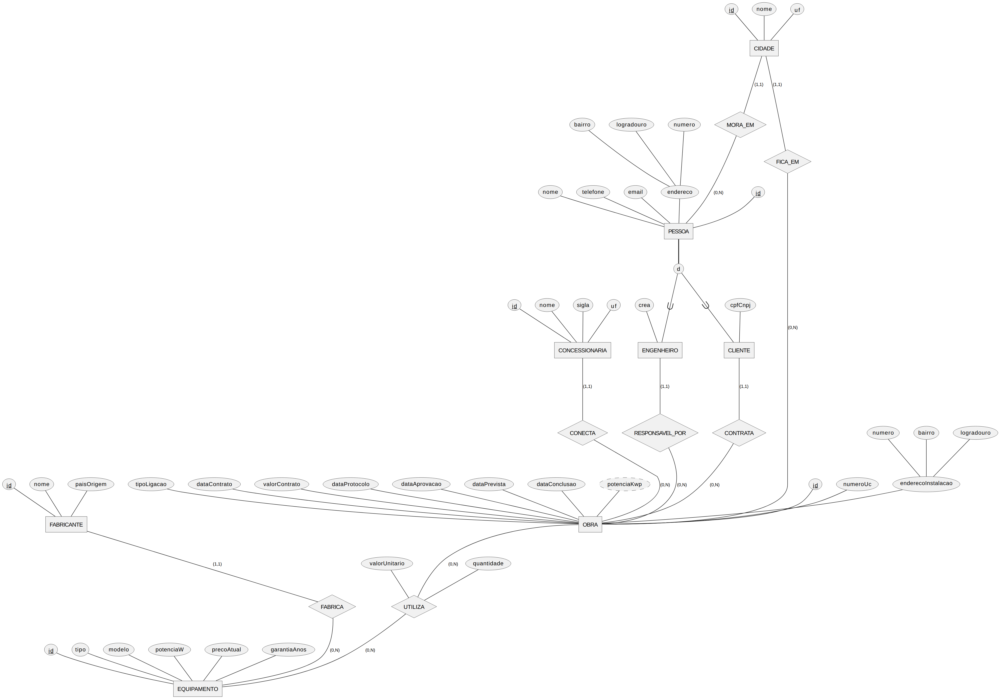

# Modelo Conceitual: Gestão Fotovoltaica

Este documento apresenta o modelo conceitual do banco de dados, feito a partir do [briefing](briefing.md) e dos [requisitos](requisitos.md). O diagrama está em [`modelo_conceitual.puml`](modelo_conceitual.puml), na notação de Peter Chen (entidades em retângulos, relacionamentos em losangos e atributos em elipses).

## Como ler as cardinalidades

Cada linha entre uma entidade e um relacionamento tem um par **(mínimo, máximo)**. O par fica ao lado da entidade e diz com quantas instâncias **dessa entidade** uma instância da outra ponta se relaciona.

Exemplo: `CLIENTE (1,1) — CONTRATA — (0,N) OBRA`
- lendo da obra para o cliente: cada obra é contratada por **exatamente um** cliente (1,1);
- lendo do cliente para a obra: cada cliente contrata de **zero a várias** obras (0,N).

## Generalização e especialização (herança)

Clientes e engenheiros têm vários dados em comum: nome, telefone, e-mail e endereço. Em vez de repetir esses atributos nas duas entidades, eles ficam na entidade genérica **PESSOA**, e cada papel vira uma **especialização** com apenas os atributos próprios:

| Especialização | Atributo próprio |
|---|---|
| **CLIENTE** | `cpfCnpj`: o CPF (pessoa física) ou o CNPJ (pessoa jurídica) |
| **ENGENHEIRO** | `crea`: o registro no conselho de engenharia |

As especializações herdam o identificador e todos os atributos de PESSOA. A especialização é:
- **total** (linha dupla no diagrama): toda pessoa cadastrada é cliente ou engenheiro, não existe "só pessoa";
- **exclusiva** (letra **d**, de *disjunta*): uma pessoa não pode ser cliente e engenheiro ao mesmo tempo (RN12).

**Por que PF e PJ não são especializações de CLIENTE.** Pessoa física e jurídica só se diferenciam pelo documento: o CPF tem 11 dígitos e o CNPJ tem 14. Criar duas especializações só para guardar um campo cada deixaria o modelo mais complexo sem ganho real. Por isso, CLIENTE tem um único atributo `cpfCnpj`, e o tipo de cliente é deduzido pelo tamanho do documento.

## Entidades

| Entidade | O que representa |
|---|---|
| **CIDADE** | Cidades onde moram as pessoas e onde ficam as obras, com o estado (UF). |
| **PESSOA** | Dados comuns a clientes e engenheiros. O endereço é um atributo composto (logradouro, número e bairro). A cidade vem do relacionamento MORA_EM. |
| **CLIENTE** | Quem contrata as obras. Especialização de PESSOA. |
| **ENGENHEIRO** | Responsável técnico pelas obras. Especialização de PESSOA. |
| **CONCESSIONARIA** | Distribuidora de energia que aprova a conexão da usina à rede. |
| **FABRICANTE** | Marca dos equipamentos. |
| **EQUIPAMENTO** | Item do catálogo: módulo, inversor, estrutura etc. A potência só se aplica a módulos e inversores. |
| **OBRA** | Instalação de uma usina para um cliente. Guarda os dados do contrato e as datas do andamento (homologação e conclusão). |

O atributo `potenciaKwp` de OBRA é **derivado** (elipse tracejada): ele não é digitado, e sim calculado pela soma de quantidade × potência dos módulos usados na obra (RN08).

## Relacionamentos

| Relacionamento | Entidades | Cardinalidade | Significado |
|---|---|---|---|
| **MORA_EM** | CIDADE – PESSOA | 1:N | Cada pessoa mora em uma cidade. Uma cidade tem várias pessoas. |
| **FICA_EM** | CIDADE – OBRA | 1:N | Cada obra fica em uma cidade. Uma cidade tem várias obras. |
| **CONTRATA** | CLIENTE – OBRA | 1:N | Cada obra é de um cliente. Um cliente pode ter várias obras. |
| **RESPONSAVEL_POR** | ENGENHEIRO – OBRA | 1:N | Cada obra tem um engenheiro responsável. Um engenheiro cuida de várias obras. |
| **CONECTA** | CONCESSIONARIA – OBRA | 1:N | Cada obra é ligada a uma concessionária. Uma concessionária atende várias obras. |
| **FABRICA** | FABRICANTE – EQUIPAMENTO | 1:N | Cada equipamento é de um fabricante. Um fabricante tem vários equipamentos. |
| **UTILIZA** | OBRA – EQUIPAMENTO | N:N | Uma obra usa vários equipamentos, e um equipamento é usado em várias obras. Tem os atributos `quantidade` e `valorUnitario`. |

## Decisões de modelagem

1. **Cidade como entidade.** O nome da cidade e a UF não ficam soltos em PESSOA e em OBRA. Assim cada cidade é cadastrada uma só vez, sem grafias diferentes para a mesma cidade ("Goiânia", "Goiania", "GOIANIA"), e a UF fica guardada junto da cidade, sem se repetir.
2. **Endereço da obra separado do endereço do cliente.** O cliente pode morar num lugar e instalar a usina em outro, como numa fazenda ou num comércio. Por isso OBRA tem o próprio endereço e a própria cidade.
3. **Valor cobrado no relacionamento UTILIZA.** O preço do catálogo (`precoAtual`) muda com o tempo. O `valorUnitario` registra quanto foi cobrado naquela obra, para o histórico não mudar quando o catálogo for atualizado (RN07).
4. **Datas do andamento na própria obra.** A obra guarda quatro datas de andamento: protocolo e aprovação da homologação, e previsão e conclusão da instalação. Como cada obra tem exatamente uma de cada, elas são atributos de OBRA, sem precisar de uma entidade de etapas.
5. **Potência derivada.** A potência da usina não é armazenada, para nunca ficar diferente dos equipamentos registrados.

## Restrições que o diagrama não consegue representar

Algumas regras não aparecem no diagrama e são garantidas no modelo lógico (com `CHECK`) ou na aplicação:
- o documento do cliente deve ter 11 ou 14 dígitos (RN01);
- o tipo de ligação deve ser monofásica, bifásica ou trifásica (RN04);
- valores e quantidades devem ser maiores que zero (RN05);
- a ordem das datas: a aprovação não vem antes do protocolo, e nenhuma data vem antes do contrato (RN06).
