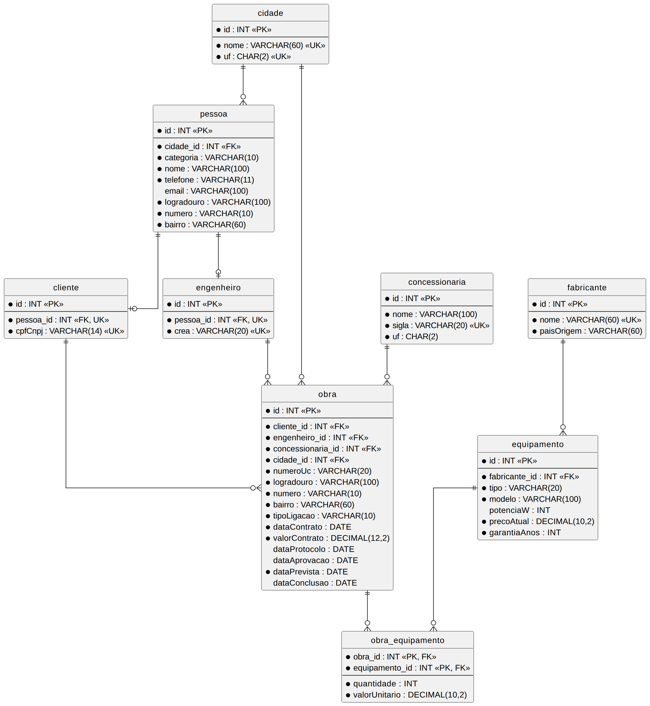

# Modelo Lógico: Gestão Fotovoltaica

Este documento apresenta o modelo lógico (relacional) do banco de dados, obtido a partir do [modelo conceitual](modelo_conceitual.md). O diagrama está em [`modelo_logico.puml`](modelo_logico.puml), na notação pé de galinha. O detalhe de cada coluna está no [dicionário de dados](dicionario_de_dados.md).

O banco tem **9 tabelas**.

## Como o modelo conceitual virou tabelas

| Elemento do modelo conceitual | Como ficou no modelo lógico |
|---|---|
| Cada entidade | Uma tabela, com a chave primária `id`. |
| Relacionamentos 1:N (MORA_EM, FICA_EM, CONTRATA, RESPONSAVEL_POR, CONECTA, FABRICA) | Chave estrangeira no lado N. Ex.: `obra.cliente_id`, `pessoa.cidade_id`. |
| Relacionamento N:N (UTILIZA) | Tabela associativa `obra_equipamento`, com chave primária composta (`obra_id`, `equipamento_id`) e os atributos do relacionamento (`quantidade`, `valorUnitario`). |
| Atributos compostos (endereço) | Uma coluna para cada parte: `logradouro`, `numero`, `bairro`. A cidade virou a chave estrangeira `cidade_id`. |
| Atributo derivado (`potenciaKwp`) | Não vira coluna. É calculado nas consultas (RN08). |
| Especialização PESSOA → CLIENTE, ENGENHEIRO | Uma tabela para a entidade genérica e uma para cada especialização (veja abaixo). |

## Mapeamento da herança

Foi usada a estratégia de **uma tabela por entidade**: `pessoa` guarda os dados comuns, e `cliente` e `engenheiro` guardam só os dados próprios de cada papel.

Cada especialização tem o **próprio `id`** (com `AUTO_INCREMENT`) e uma coluna **`pessoa_id`**, que é chave estrangeira para `pessoa` e é **única**. O `UNIQUE` garante que cada pessoa tenha no máximo um registro de cliente e no máximo um de engenheiro, o que faz do relacionamento um 1:1. As outras tabelas apontam para a especialização: `obra.cliente_id` aponta para `cliente.id`, e não para `pessoa.id`.

A coluna **`pessoa.categoria`** (`cliente` ou `engenheiro`) indica o papel de cada pessoa. Ela facilita as listagens e ajuda a aplicação a garantir que uma pessoa não seja cliente e engenheiro ao mesmo tempo (RN12).

Como os dados de uma pessoa ficam em duas tabelas, o cadastro de um cliente ou engenheiro grava em `pessoa` e depois na especialização dentro de uma **transação** (RNF13): ou grava nas duas, ou não grava em nenhuma. Na exclusão, basta excluir a linha de `pessoa`, e a chave estrangeira com `ON DELETE CASCADE` exclui a especialização junto.

O cliente não tem coluna de tipo (pessoa física ou jurídica): o tipo é deduzido pelo tamanho de `cpfCnpj`, com 11 dígitos para CPF e 14 para CNPJ. Guardar o tipo seria redundante e poderia criar inconsistências, como um cliente marcado como pessoa física com um CNPJ.

## Esquema relacional

Notação: chave primária em **negrito e itálico**, chave estrangeira em *itálico*.

- **cidade** (***id***, nome, uf)
- **pessoa** (***id***, *cidade_id*, categoria, nome, telefone, email, logradouro, numero, bairro)
- **cliente** (***id***, *pessoa_id*, cpfCnpj)
- **engenheiro** (***id***, *pessoa_id*, crea)
- **concessionaria** (***id***, nome, sigla, uf)
- **fabricante** (***id***, nome, paisOrigem)
- **equipamento** (***id***, *fabricante_id*, tipo, modelo, potenciaW, precoAtual, garantiaAnos)
- **obra** (***id***, *cliente_id*, *engenheiro_id*, *concessionaria_id*, *cidade_id*, numeroUc, logradouro, numero, bairro, tipoLigacao, dataContrato, valorContrato, dataProtocolo, dataAprovacao, dataPrevista, dataConclusao)
- **obra_equipamento** (***obra_id***, ***equipamento_id***, quantidade, valorUnitario)

## Restrições de integridade

### Chaves únicas

| Tabela | Coluna(s) | Por quê |
|---|---|---|
| cidade | (nome, uf) | Não existem duas cidades com o mesmo nome no mesmo estado (RN13). A chave é composta porque há cidades com o mesmo nome em estados diferentes. |
| cliente | pessoa_id | Uma pessoa é no máximo um cliente (herança 1:1). |
| cliente | cpfCnpj | Não pode haver dois clientes com o mesmo documento (RN01). |
| engenheiro | pessoa_id | Uma pessoa é no máximo um engenheiro (herança 1:1). |
| engenheiro | crea | Não pode haver dois engenheiros com o mesmo CREA (RN02). |
| concessionaria | sigla | A sigla identifica a concessionária (ex.: `EQUATORIAL-GO`). |
| fabricante | nome | Evita cadastrar a mesma marca duas vezes. |

### Domínios (CHECK)

| Tabela | Regra |
|---|---|
| pessoa | `categoria` em (`cliente`, `engenheiro`) |
| cliente | `cpfCnpj` só com números e com 11 ou 14 dígitos (RN01) |
| equipamento | `tipo` em (`modulo`, `inversor`, `microinversor`, `estrutura`, `string_box`, `cabo`) |
| equipamento | `potenciaW` > 0, `precoAtual` > 0, `garantiaAnos` >= 0 |
| obra | `tipoLigacao` em (`monofasica`, `bifasica`, `trifasica`) (RN04) |
| obra | `valorContrato` > 0 (RN05) |
| obra | `dataProtocolo`, `dataPrevista` e `dataConclusao` >= `dataContrato` (RN06) |
| obra | `dataAprovacao` >= `dataProtocolo`, e a aprovação só pode ser preenchida se o protocolo também estiver (RN06) |
| obra_equipamento | `quantidade` > 0 e `valorUnitario` > 0 (RN05) |

Um `CHECK` sobre uma coluna vazia (`NULL`) não bloqueia a gravação. Por isso as regras de datas só são verificadas quando as datas estão preenchidas.

### Chaves estrangeiras

| Chave estrangeira | Ao excluir o registro referenciado | Por quê |
|---|---|---|
| `cliente.pessoa_id`, `engenheiro.pessoa_id` | **CASCADE** | Excluir a pessoa exclui o papel dela (herança). |
| `obra_equipamento.obra_id` | **CASCADE** | Os equipamentos registrados na obra só existem dentro dela (RN03). |
| Todas as outras: `pessoa.cidade_id`, `obra.cliente_id`, `obra.engenheiro_id`, `obra.concessionaria_id`, `obra.cidade_id`, `equipamento.fabricante_id`, `obra_equipamento.equipamento_id` | **RESTRICT** | Não deixa excluir um registro em uso, como um cliente com obras ou um equipamento já usado (RN03). |

Repare no efeito combinado: excluir a pessoa de um cliente com obras é bloqueado, porque o CASCADE tentaria excluir o cliente, e o RESTRICT de `obra.cliente_id` impede.

### Campos opcionais (aceitam NULL)

| Coluna | Por quê |
|---|---|
| `pessoa.email` | Nem todo cliente tem e-mail. |
| `equipamento.potenciaW` | Estruturas, cabos e string box não têm potência. |
| `obra.dataProtocolo`, `obra.dataAprovacao`, `obra.dataConclusao` | Ficam vazias até a homologação ser pedida, ser aprovada e a instalação terminar. |

### Regras que ficam na aplicação

- Uma pessoa não pode ser cliente e engenheiro ao mesmo tempo (RN12): a aplicação grava a `categoria` e só cria o registro na especialização correspondente.
- O valor unitário sugerido a partir do preço do catálogo (RN07).
- Os cálculos de kWp, dias de homologação e vencimento de garantia (RN08 a RN11), feitos nas consultas.

## Normalização

### 1ª Forma Normal: valores atômicos e sem grupos repetidos

- O endereço foi dividido em colunas (`logradouro`, `numero`, `bairro`, `cidade_id`), em vez de um texto único.
- Os equipamentos de uma obra não ficam em colunas repetidas (`equipamento1`, `equipamento2`...) nem numa lista dentro de uma coluna: cada um é uma linha de `obra_equipamento`.
- O `cpfCnpj` é atômico: guarda um único documento, só com números.

### 2ª Forma Normal: sem dependência parcial da chave

Só a tabela `obra_equipamento` tem chave composta. Os atributos dela (`quantidade` e `valorUnitario`) dependem da chave inteira, ou seja, da obra **e** do equipamento juntos. Os dados que dependem só do equipamento, como o modelo, o fabricante e o preço atual, ficam em `equipamento`.

### 3ª Forma Normal: sem dependência transitiva

- A UF depende da cidade, e não da pessoa ou da obra. Por isso a cidade e a UF ficam na tabela `cidade`, e `pessoa` e `obra` guardam só a `cidade_id`.
- O nome do fabricante depende do fabricante, e não do equipamento. Por isso `equipamento` guarda só a `fabricante_id`.
- Os dados do cliente, do engenheiro e da concessionária não se repetem em `obra`: ficam só as chaves estrangeiras.
- A potência da obra (kWp) não é guardada, porque dependeria dos equipamentos e não da obra.

## Observações de modelagem

- **Nomes:** as tabelas ficam no singular e em *snake_case*. As colunas comuns ficam em *camelCase* (`dataContrato`, `valorUnitario`), e as chaves estrangeiras seguem o padrão `tabela_id` (`cliente_id`). É o mesmo padrão do banco de exemplo da disciplina.
- **Povoamento:** com 10 clientes e 10 engenheiros, a tabela `pessoa` terá pelo menos 20 linhas.
